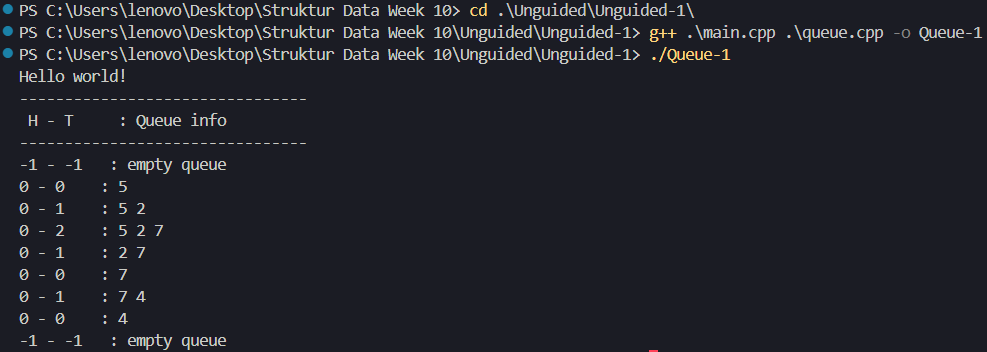
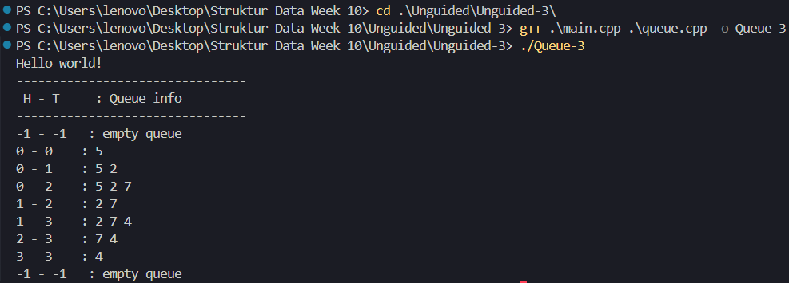

# <h1 align="center">Laporan Praktikum Modul 8 - QUEUE</h1>
<p align="center">Arvin Ihsan Fatih - 109082500050</p>

## Dasar Teori
Queue atau antrean adalah salah satu struktur data linear yang digunakan dalam pemrograman untuk menyimpan sekumpulan elemen dengan menerapkan prinsip FIFO (First-In-First-Out), yang berarti elemen yang pertama kali masuk ke dalam antrean akan menjadi elemen yang pertama pula keluar dari antrean. Konsep ini menyerupai antrean dalam kehidupan sehari-hari, di mana orang yang pertama kali datang atau mengantri akan dilayani terlebih dahulu[1].

### A. Fungsi dan Cara Kerja Queue<br/>
Pengelolaan data dalam queue memegang peranan penting untuk menjaga keterurutan proses dalam sistem komputer.
#### 1. Queue berfungsi untuk mengatur urutan tugas secara sekuensial, membantu penjadwalan pekerjaan, melakukan buffering data sementara, serta mendukung penerapan algoritma pencarian seperti BFS (Breadth-First Search). Selain itu, struktur ini juga banyak digunakan dalam simulasi dunia nyata, manajemen memori, pengelolaan pesan aplikasi chat, hingga sistem antrean pada layanan publik.
#### 2. Cara Kerja : Elemen baru yang dimasukkan ke dalam antrean akan ditempatkan pada ujung belakang, sementara elemen di bagian depan menjadi prioritas utama untuk dikeluarkan terlebih dahulu. Ketika sebuah elemen berhasil dikeluarkan, elemen-elemen di belakangnya akan otomatis maju satu langkah ke depan[1].

### B. Jenis-Jenis Queue<br/>
Berdasarkan pola akses dan karakteristik pengelolaannya, struktur data queue terbagi menjadi beberapa jenis utama.
#### 1. Simple Queue.
#### 2. Circular Queue.
#### 3. Priority Queue.
#### 4. Double-Ended Queue (Deque)[1].

## Guided #1

### 1. queue.h

```C++
#ifndef QUEUE_H_INCLUDE
#define QUEUE_H_INCLUDE

#include <iostream>
using namespace std;

#define Nil NULL

typedef int infotype;
typedef bool boolean;

typedef struct elmQ *address;

struct elmQ {
    infotype info;
    address next;
};

/* Deklarasi tipe data queue */
struct queue {
    address head;
    address tail;
};

/********* Pengecekan apakah queue kosong *********/
boolean isEmpty(queue Q);
/* Mengembalikan true jika queue kosong */

/********* Pembuatan queue kosong *********/
void CreateQueue(queue &Q);
/* I.S. sembarang
   F.S. terbentuk queue kosong */

/********* Manajemen memori *********/
address alokasi(infotype X);
/* Mengirimkan address hasil alokasi elemen.
   Jika berhasil, mengembalikan address baru.
   Jika gagal, mengembalikan Nil */

void dealokasi(address P);
/* I.S. P terdefinisi
   F.S. memori yang digunakan P dikembalikan ke sistem */

/********* Pencarian elemen *********/
address findElm(queue Q, infotype X);
/* Mencari elemen dengan info = X.
   Jika ditemukan mengembalikan address elemen,
   jika tidak mengembalikan Nil */

boolean fFindElm(queue Q, address P);
/* Mencari apakah elemen dengan alamat P ada dalam queue.
   Mengembalikan true jika ada, false jika tidak */

/********* Penambahan elemen *********/
void insert(queue &Q, address P);
/* I.S. P sudah dialokasikan
   F.S. P ditambahkan pada akhir queue */

/********* Penghapusan elemen *********/
void deleteQueue(queue &Q, address &P);
/* I.S. queue tidak kosong
   F.S. P menunjuk elemen pertama queue,
        head berpindah ke elemen berikutnya.
        Queue mungkin menjadi kosong */

/********* Proses semua elemen queue *********/
void printInfo(queue Q);
/* Menampilkan seluruh isi queue */

int nbList(queue Q);
/* Mengembalikan jumlah elemen queue */

void delAll(queue &Q);
/* Menghapus seluruh elemen queue dan dealokasi memori */

#endif
```
queue.h berfungsi untuk mendefinisikan struktur data Queue berbasis pointer (linked list) yang terdiri dari komponen penunjuk head dan tail. Di dalamnya juga mendeklarasikan berbagai prototipe fungsi dan prosedur pendukung esensial, seperti pemeriksaan antrean kosong melalui isEmpty, inisialisasi CreateQueue, manajemen memori (alokasi dan dealokasi), pencarian elemen (findElm dan fFindElm), operasi utama penyisipan dan penghapusan (insert serta deleteQueue), hingga fungsi utilitas untuk menampilkan (printInfo), menghitung jumlah (nbList), dan menghapus seluruh isi antrean (delAll).

### 2. queue.cpp

```C++
#include "queue.h"

boolean isEmpty(queue Q) {
    return (Q.head == Nil);
}

void CreateQueue(queue &Q) {
    Q.head = Nil;
    Q.tail = Nil;
}

address alokasi(infotype X) {
    address P = new (nothrow) elmQ;
    if (P != Nil) {
        P->info = X;
        P->next = Nil;
    }
    return P;
}

void dealokasi(address P) {
    delete P;
}

address findElm(queue Q, infotype X) {
    address P = Q.head;
    while (P != Nil) {
        if (P->info == X) {
            return P;
        }
        P = P->next;
    }
    return Nil;
}

boolean fFindElm(queue Q, address P) {
    address R = Q.head;
    while (R != Nil) {
        if (R == P) {
            return true;
        }
        R = R->next;
    }
    return false;
}

void insert(queue &Q, address P) {
    if (isEmpty(Q)) {
        Q.head = P;
        Q.tail = P;
    } else {
        (Q.tail)->next = P;
        Q.tail = P;
    }
}

void deleteQueue(queue &Q, address &P) {
    P = Q.head;
    if (Q.head == Q.tail) {
        Q.head = Nil;
        Q.tail = Nil;
    } else {
        Q.head = P->next;
    }
    P->next = Nil;
}

void printInfo(queue Q) {
    if (isEmpty(Q)) {
        cout << "Queue kosong" << endl;
    } else {
        address P = Q.head;
        while (P != Nil) {
            cout << P->info << " ";
            P = P->next;
        }
        cout << endl;
    }
}

int nbList(queue Q) {
    int jumlah = 0;
    address P = Q.head;
    while (P != Nil) {
        jumlah++;
        P = P->next;
    }
    return jumlah;
}

void delAll(queue &Q) {
    address P;
    while (!isEmpty(Q)) {
        deleteQueue(Q, P);
        dealokasi(P);
    }
}
```
queue.cpp berisi implementasi fungsi dan prosedur yang telah dideklarasikan sebelumnya. Di dalamnya terdapat fungsi dasar seperti isEmpty untuk memeriksa kekosongan antrean dan CreateQueue untuk melakukan inisialisasi pointer head dan tail menjadi Nil. Terdapat pula fungsi manajemen memori (alokasi dan dealokasi), pencarian elemen (findElm dan fFindElm), operasi utama antrean berupa penyisipan data di akhir melalui insert serta penghapusan data di awal melalui deleteQueue, hingga fungsi utilitas untuk menampilkan informasi (printInfo), menghitung total elemen (nbList), dan menghapus seluruh isi antrean secara menyeluruh (delAll).

### 3. main.cpp

```C++
#include <iostream>
#include "queue.h"
using namespace std;

int main() {
  queue Q;
  address P;

  CreateQueue(Q);
  cout << "isEmpty : " << isEmpty(Q) << endl;
  printInfo(Q);

  insert(Q, alokasi(5));
  insert(Q, alokasi(2));
  insert(Q, alokasi(7));
  cout << "Setelah insert 5, 2, 7" << endl;
  printInfo(Q);
  cout << "nbList : " << nbList(Q) << endl;

  P = findElm(Q, 2);
  if (P != Nil) {
    cout << "findElm(2) ketemu, info = " << P->info << endl;
    cout << "fFindElm : " << fFindElm(Q, P) << endl;
  }

  deleteQueue(Q, P);
  cout << "Setelah delete, elemen yang keluar = " << P->info << endl;
  dealokasi(P);
  printInfo(Q);

  delAll(Q);
  cout << "Setelah delAll" << endl;
  printInfo(Q);
  cout << "isEmpty : " << isEmpty(Q) << endl;

  return 0;
}
```
main.cpp berfungsi sebagai program utama (driver) untuk menguji seluruh pengoperasian ADT Queue secara menyeluruh. Program ini menginisialisasi antrean kosong, melakukan penambahan beberapa elemen (5, 2, dan 7) menggunakan prosedur insert, menghitung jumlah elemen, mencari elemen tertentu dengan fungsi findElm dan fFindElm, melakukan penghapusan elemen di awal antrean melalui deleteQueue, serta mengosongkan seluruh isi antrean menggunakan delAll guna memastikan seluruh primitif antrean berjalan dengan baik sesuai prinsip FIFO.

## Guided #2

### 1. queue.h

```C++
#ifndef QUEUE_H
#define QUEUE_H

#include <iostream>
using namespace std;

const int MAKSIMAL = 5;

struct queue {
    string nama[MAKSIMAL];
    int head;
    int tail;
};

bool isFull(queue Q);
bool isEmpty(queue Q);
void CreateQueue(queue &Q);
void enQueue(queue &Q, string nama);
void deQueue(queue &Q);
void viewQueue(queue Q);

#endif
```
queue.h ini mendefinisikan ADT Queue menggunakan representasi tabel atau array berkapasitas maksimum 5 elemen dengan studi kasus penyimpanan data string berupa nama. Di dalamnya dideklarasikan struktur queue yang memuat array nama serta variabel head dan tail sebagai penunjuk antrean, beserta prototipe fungsi dan prosedur pendukung seperti isFull, isEmpty, CreateQueue, enQueue, deQueue, dan viewQueue.

### 2. queue.cpp

```C++
#include "queue.h"
#include <iostream>

using namespace std;

// NOTE : 
// Implementasi 1 = head diam, tail bergerak (Queue Linear Statis, kerana head nya tetap diam)
// Implementasi 2 = head bergerak, tail bergerak (Queue Linear Dinamis, karena head & tail nya sama-sama bergerak)
// Implementasi 3 = head dan tail berputar (Queue Circular, karena jika udh mentok tapi masih ada space, diputar sehingga tail bisa ada didepan head)

bool isEmpty(queue Q){
    if(Q.head == -1 && Q.tail == -1){
        return true;
    } else {
        return false;
    }
}

//isFull implmenetasi 1 & 2
bool isFull(queue Q){
    if(Q.tail == MAKSIMAL - 1){
        return true;
    } else {
        return false;
    }
}

// //isFull implementasi 3
// bool isFull(queue Q){
//     if((Q.tail + 1) % MAKSIMAL == Q.head){
//         return true;
//     } else {
//         return false;
//     }
// }

void CreateQueue(queue &Q){ //terbentuk queue dengan head = -1 dan tail = -1 
    Q.head = -1;
    Q.tail = -1;
}
 

//enqueue implementasi 1 & 2
void enQueue(queue &Q, string nama){
    if(isFull(Q) == true){
        cout << "Queue sudah penuh!" << endl;
    } else {
        if(isEmpty(Q) == true){
            Q.head = Q.tail = 0;
        } else {
            Q.tail++;
        }
        Q.nama[Q.tail] = nama;
        cout << "nama " << nama << " berhasil ditambahkan kedalam queue!" << endl;
    }
}

// //enQueue implementasi 3
// void enQueue(queue &Q, string nama){
//     if(isFull(Q) == true){
//         cout << "Queue sudah penuh!" << endl;
//     } else {
//         if(isEmpty(Q) == true){
//             Q.head = Q.tail = 0;
//         } else {
//             Q.tail = (Q.tail + 1) % MAKSIMAL; // bergerak melingkar
//         }
//         Q.nama[Q.tail] = nama;
//         cout << "nama " << nama << " berhasil ditambahkan kedalam queue!" << endl;
//     }
// }

//dequeue implementasi 1
void deQueue(queue &Q){
    if(isEmpty(Q) == true){
        cout << "Queue kosong!" << endl;
    } else {
        cout << "Mengahapus data " << Q.nama[Q.head] << "..." << endl;
        for(int i = 0; i < Q.tail; i++){
            Q.nama[i] =  Q.nama[i+1];
        }
        Q.tail--;
        if(Q.tail < 0){ //kalo semua isi queue nya udh dikelaurin, set head & tail ke -1
            Q.head = -1;
            Q.tail = -1;
        }
    }
}

// //dequeue implementasi 2
// void deQueue(queue &Q){
//     if(isEmpty(Q) == true){
//         cout << "Queue kosong!" << endl;
//     } else {
//         cout << "Mengahapus data " << Q.nama[Q.head] << "..." << endl;
//         Q.head++;
//         if(Q.head > Q.tail){ //kalo elemennya udh abis (head akan lebih 1 dari tail), maka reset ulang head & tail ke -1
//             Q.head = -1;
//             Q.tail = -1;
//         }
//     }
// }

// //deQueue implementasi 3
// void deQueue(queue &Q){
//     if(isEmpty(Q) == true){
//         cout << "Queue kosong!" << endl;
//     } else {
//         cout << "Mengahapus data " << Q.nama[Q.head] << "..." << endl;
//         if(Q.head == Q.tail){ //kalo elemennya tinggal 1, langsungkan saja head & tail nya reset ke -1
//             Q.head = -1;
//             Q.tail = -1;
//         } else {
//             Q.head = (Q.head + 1) % MAKSIMAL; // bergerak melingkar
//         }
//     }
// }

//viewQueue implementasi 1 & 2
void viewQueue(queue Q){
    if(isEmpty(Q) == true){
        cout << "Queue kosong!" << endl;
    } else {
        for(int i = Q.head; i <= Q.tail; i++){
            cout << i -  Q.head + 1 << ". " << Q.nama[i] << endl;
        }
    }
    cout << endl;
}

// //viewQueue implementasi 3
// void viewQueue(queue Q){
//     if(isEmpty(Q) == true){
//         cout << "Queue kosong!" << endl;
//     } else {
//         int i = Q.head;
//         int count = 1;
//         while(true){
//             cout << count << ". " << Q.nama[i] << endl;
//             if(i == Q.tail){
//                 break;
//             }
//             i = (i + 1) % MAKSIMAL;
//             count++;
//         }   
//     }
// }
```
queue.cpp ini berisi implementasi fungsi dan prosedur untuk ADT Queue berbasis representasi tabel (array) dengan kapasitas maksimum 5 elemen. Di dalamnya memuat realisasi logika utama seperti pemeriksaan kondisi kosong (isEmpty) dan penuh (isFull), inisialisasi antrean melalui CreateQueue, penambahan data (enQueue), penghapusan data (deQueue), serta penampilan isi antrean (viewQueue), di mana kode ini juga menyediakan variasi alternatif implementasi (mulai dari head diam, head bergerak, hingga circular queue yang berputar).

### 3. main.cpp

```C++
#include "queue.h"
#include <iostream>

using namespace std;

int main(){
    queue Q;

    CreateQueue(Q);
    enQueue(Q, "Dimas");
    enQueue(Q, "Arvin");
    enQueue(Q, "Rizal");
    enQueue(Q, "Hafizh");
    enQueue(Q, "Fathur");
    enQueue(Q, "Daffa");
    cout << endl;

    cout << "--- Isi Queue Setelah enQueue ---" << endl;
    viewQueue(Q);
    cout << endl;

    deQueue(Q);
    deQueue(Q);
    deQueue(Q);
    deQueue(Q);
    // deQueue(Q);
    // deQueue(Q);
    cout << endl;

    cout << "--- Isi Queue Setelah deQueue ---" << endl;
    viewQueue(Q);

    return 0;
}
```
main.cpp bertindak sebagai program utama (driver) untuk menguji fungsionalitas ADT Queue berbasis array. Program ini menginisialisasi antrean kosong melalui CreateQueue, menambahkan 6 nama ke dalam antrean (yang mana nama keenam akan memicu pesan bahwa queue sudah penuh karena kapasitas maksimumnya adalah 5 elemen), menampilkan seluruh isi antrean menggunakan viewQueue, serta melakukan operasi penghapusan data (deQueue) sebanyak 4 kali untuk menguji perpindahan posisi elemen di dalam antrean.

## Unguided 

### 1. Buatlah ADT Queue menggunakan ARRAY sebagai berikut di dalam file “queue.h”. Buatlah implementasi ADT Queue pada file “queue.cpp” dengan menerapkan mekanisme queue  Alternatif 1 (head diam, tail bergerak).

### queue.h
```C++
#ifndef QUEUE_H_INCLUDED
#define QUEUE_H_INCLUDED

#include <iostream>

using namespace std;

typedef int infotype;

struct Queue {
    infotype info[5];
    int head;
    int tail;
};

void createQueue(Queue &Q);
bool isEmptyQueue(Queue Q);
bool isFullQueue(Queue Q);
void enqueue(Queue &Q, infotype x);
infotype dequeue(Queue &Q);
void printInfo(Queue Q);

#endif
```

### queue.cpp
```C++
#include "queue.h"

void createQueue(Queue &Q) {
    Q.head = -1;
    Q.tail = -1;
}

bool isEmptyQueue(Queue Q) {
    return (Q.head == -1 && Q.tail == -1);
}

bool isFullQueue(Queue Q) {
    return (Q.tail == 4);
}

void enqueue(Queue &Q, infotype x) {
    if (isFullQueue(Q)) {
        cout << "Queue sudah penuh!" << endl;
    } else {
        if (isEmptyQueue(Q)) {
            Q.head = 0;
            Q.tail = 0;
        } else {
            Q.tail++;
        }
        Q.info[Q.tail] = x;
    }
}

infotype dequeue(Queue &Q) {
    infotype x = -1;
    if (isEmptyQueue(Q)) {
        cout << "Queue kosong!" << endl;
    } else {
        x = Q.info[Q.head];
        for (int i = Q.head; i < Q.tail; i++) {
            Q.info[i] = Q.info[i + 1];
        }
        Q.tail--;
        if (Q.tail < 0) {
            Q.head = -1;
            Q.tail = -1;
        }
    }
    return x;
}

void printInfo(Queue Q) {
    if (Q.head == -1) {
        cout << Q.head << " - " << Q.tail << "   : ";
    } else {
        cout << Q.head << " - " << Q.tail << "    : ";
    }
    
    if (isEmptyQueue(Q)) {
        cout << "empty queue" << endl;
    } else {
        for (int i = Q.head; i <= Q.tail; i++) {
            cout << Q.info[i] << " ";
        }
        cout << endl;
    }
}
```

### main.cpp
```C++
#include <iostream>
#include "queue.h"

using namespace std;

int main() {
    cout << "Hello world!" << endl;
    Queue Q;
    createQueue(Q);

    cout << "--------------------------------" << endl;
    cout << " H - T     : Queue info" << endl;
    cout << "--------------------------------" << endl;
    
    printInfo(Q);
    enqueue(Q, 5); printInfo(Q);
    enqueue(Q, 2); printInfo(Q);
    enqueue(Q, 7); printInfo(Q);
    dequeue(Q); printInfo(Q);
    dequeue(Q); printInfo(Q);
    enqueue(Q, 4); printInfo(Q);
    dequeue(Q); printInfo(Q);
    dequeue(Q); printInfo(Q);

    return 0;
}
```

### Output Unguided 1 :


Implementasi Unguided Nomor 1 ini menggunakan struktur data Queue berbasis array dengan mekanisme Alternatif 1, di mana posisi head dipertahankan tetap di indeks awal (0) dan tail bergerak seiring penambahan data. Berdasarkan pengujian pada program utama, inisialisasi antrean kosong menghasilkan posisi -1 - -1, yang kemudian berubah secara dinamis saat operasi enqueue memasukkan elemen (5, 2, 7) dan operasi dequeue melakukan penghapusan serta pergeseran elemen ke depan sesuai prinsip FIFO (First-In-First-Out) hingga antrean kembali kosong.

### 2. Buatlah implementasi ADT Queue pada file “queue.cpp” dengan menerapkan mekanisme queue Alternatif 2 (head bergerak, tail bergerak).

### queue.h
```C++
#ifndef QUEUE_H_INCLUDED
#define QUEUE_H_INCLUDED

#include <iostream>

using namespace std;

typedef int infotype;

struct Queue {
    infotype info[5];
    int head;
    int tail;
};

void createQueue(Queue &Q);
bool isEmptyQueue(Queue Q);
bool isFullQueue(Queue Q);
void enqueue(Queue &Q, infotype x);
infotype dequeue(Queue &Q);
void printInfo(Queue Q);

#endif
```

### queue.cpp
```C++
#include "queue.h"

void createQueue(Queue &Q) {
    Q.head = -1;
    Q.tail = -1;
}

bool isEmptyQueue(Queue Q) {
    return (Q.head == -1 && Q.tail == -1);
}

bool isFullQueue(Queue Q) {
    return (Q.tail == 4);
}

void enqueue(Queue &Q, infotype x) {
    if (isFullQueue(Q)) {
        cout << "Queue sudah penuh!" << endl;
    } else {
        if (isEmptyQueue(Q)) {
            Q.head = 0;
            Q.tail = 0;
        } else {
            Q.tail++;
        }
        Q.info[Q.tail] = x;
    }
}

infotype dequeue(Queue &Q) {
    infotype x = -1;
    if (isEmptyQueue(Q)) {
        cout << "Queue kosong!" << endl;
    } else {
        x = Q.info[Q.head];
        Q.head++;
        
        if (Q.head > Q.tail) {
            Q.head = -1;
            Q.tail = -1;
        }
    }
    return x;
}

void printInfo(Queue Q) {
    if (Q.head == -1) {
        cout << Q.head << " - " << Q.tail << "   : ";
    } else {
        cout << Q.head << " - " << Q.tail << "    : ";
    }
    
    if (isEmptyQueue(Q)) {
        cout << "empty queue" << endl;
    } else {
        for (int i = Q.head; i <= Q.tail; i++) {
            cout << Q.info[i] << " ";
        }
        cout << endl;
    }
}
```

### main.cpp
```C++
#include <iostream>
#include "queue.h"

using namespace std;

int main() {
    cout << "Hello world!" << endl;
    Queue Q;
    createQueue(Q);

    cout << "--------------------------------" << endl;
    cout << " H - T     : Queue info" << endl;
    cout << "--------------------------------" << endl;
    
    printInfo(Q);
    enqueue(Q, 5); printInfo(Q);
    enqueue(Q, 2); printInfo(Q);
    enqueue(Q, 7); printInfo(Q);
    dequeue(Q); printInfo(Q);
    enqueue(Q, 4); printInfo(Q);
    dequeue(Q); printInfo(Q);
    dequeue(Q); printInfo(Q);
    dequeue(Q); printInfo(Q);

    return 0;
}
```

### Output Unguided 2 :


Implementasi Unguided Nomor 2 ini menggunakan struktur data Queue berbasis array dengan menerapkan mekanisme Alternatif 2, di mana pointer head dan tail sama-sama bergerak secara dinamis. Berbeda dengan mekanisme sebelumnya, pada pendekatan ini operasi dequeue tidak memerlukan pergeseran elemen ke depan satu per satu, melainkan posisi head yang berjalan maju setiap kali data dihapus. Hal ini terbukti dari hasil pengujian program di mana nilai indeks head bertambah secara bertahap (dari 0, 1, 2, hingga 3) saat proses penghapusan berlangsung, sampai akhirnya antrean kembali kosong dan diatur ulang menjadi -1 - -1.

### 3. Buatlah implementasi ADT Queue pada file “queue.cpp” dengan menerapkan mekanisme queue Alternatif 3 (head dan tail berputar).

### queue.h
```C++
#ifndef QUEUE_H_INCLUDED
#define QUEUE_H_INCLUDED

#include <iostream>

using namespace std;

typedef int infotype;
const int MAKSIMAL = 5;

struct Queue {
    infotype info[MAKSIMAL];
    int head;
    int tail;
};

void createQueue(Queue &Q);
bool isEmptyQueue(Queue Q);
bool isFullQueue(Queue Q);
void enqueue(Queue &Q, infotype x);
infotype dequeue(Queue &Q);
void printInfo(Queue Q);

#endif
```

### queue.cpp
```C++
#include "queue.h"

void createQueue(Queue &Q) {
    Q.head = -1;
    Q.tail = -1;
}

bool isEmptyQueue(Queue Q) {
    return (Q.head == -1 && Q.tail == -1);
}

bool isFullQueue(Queue Q) {
    return ((Q.tail + 1) % MAKSIMAL == Q.head);
}

void enqueue(Queue &Q, infotype x) {
    if (isFullQueue(Q)) {
        cout << "Queue sudah penuh!" << endl;
    } else {
        if (isEmptyQueue(Q)) {
            Q.head = 0;
            Q.tail = 0;
        } else {
            Q.tail = (Q.tail + 1) % MAKSIMAL;
        }
        Q.info[Q.tail] = x;
    }
}

infotype dequeue(Queue &Q) {
    infotype x = -1;
    if (isEmptyQueue(Q)) {
        cout << "Queue kosong!" << endl;
    } else {
        x = Q.info[Q.head];
        if (Q.head == Q.tail) {
            Q.head = -1;
            Q.tail = -1;
        } else {
            Q.head = (Q.head + 1) % MAKSIMAL;
        }
    }
    return x;
}

void printInfo(Queue Q) {
    if (Q.head == -1) {
        cout << Q.head << " - " << Q.tail << "   : ";
    } else {
        cout << Q.head << " - " << Q.tail << "    : ";
    }
    
    if (isEmptyQueue(Q)) {
        cout << "empty queue" << endl;
    } else {
        int i = Q.head;
        while (true) {
            cout << Q.info[i] << " ";
            if (i == Q.tail) {
                break;
            }
            i = (i + 1) % MAKSIMAL;
        }
        cout << endl;
    }
}
```

### main.cpp
```C++
#include <iostream>
#include "queue.h"

using namespace std;

int main() {
    cout << "Hello world!" << endl;
    Queue Q;
    createQueue(Q);

    cout << "--------------------------------" << endl;
    cout << " H - T     : Queue info" << endl;
    cout << "--------------------------------" << endl;
    
    printInfo(Q);
    enqueue(Q, 5); printInfo(Q);
    enqueue(Q, 2); printInfo(Q);
    enqueue(Q, 7); printInfo(Q);
    dequeue(Q); printInfo(Q);
    enqueue(Q, 4); printInfo(Q);
    dequeue(Q); printInfo(Q);
    dequeue(Q); printInfo(Q);
    dequeue(Q); printInfo(Q);

    return 0;
}
```

### Output Unguided 3 :


Implementasi Unguided Nomor 3 ini menerapkan mekanisme circular queue (Alternatif 3) di mana pointer head dan tail dapat bergerak berputar menggunakan operasi modulus, meskipun output layarnya terlihat sama persis dengan nomor 2 karena jumlah data uji belum mencapai batas maksimum untuk memicu sifat wrap around. Perbedaan utamanya terletak pada efisiensi ruang memori, jika Alternatif 2 bersifat linier sehingga penambahan data akan ditolak ketika tail di ujung meskipun depan kosong, Alternatif 3 mampu memutar kembali pointer tail ke indeks awal untuk memanfaatkan ruang kosong tersebut.

## Kesimpulan
Praktikum Modul 8 ini menunjukkan bahwa struktur data Queue menganut prinsip FIFO (First In, First Out), di mana elemen yang pertama masuk akan menjadi yang pertama pula keluar. Melalui perbandingan ketiga alternatif implementasi berbasis array, yaitu Alternatif 1 dengan pergeseran elemen statis, Alternatif 2 dengan pergerakan head dan tail linier, serta Alternatif 3 berupa circular queue berputar, terbukti bahwa setiap pendekatan memiliki efisiensi penyimpanan dan mekanisme pengelolaan memori yang berbeda. Pemilihan alternatif implementasi tersebut sangat bergantung pada kebutuhan sistem serta batasan kapasitas memori yang digunakan dalam menangani aliran antrean data.

## Referensi
[1] Annisa. (n.d.). Fakultas Ilmu Komputer dan Teknologi Informasi Universitas Muhammadiyah Sumatera Utara (FIKTI UMSU). "Struktur Data Queue: Pengertian, Fungsi, dan Jenisnya". Diakses pada 18 November 2026 melalui https://fikti.umsu.ac.id/struktur-data-queue-pengertian-fungsi-dan-jenisnya/.